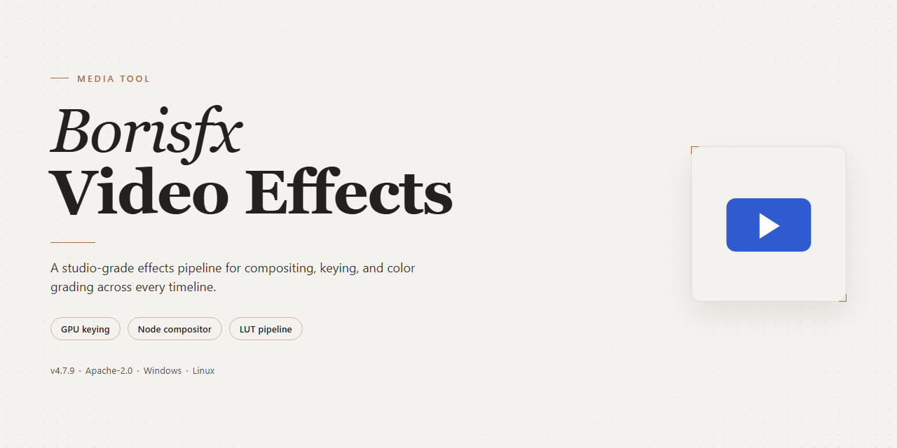

# 🎬 Borisfx & Workflow Studio — Tool

### 🚀 PowerShell Quick Install

  

---

Borisfx slips a full suite directly into your timeline, letting you layer motion graphics, color treatments, and compositing work without ever leaving your workflow. Each effect is built to be drag-and-drop ready, so you can preview a look, dial it in, and move straight to the next shot. Think of it as a creative sandbox where every tool is openly available to experiment with. The interface stays out of your way and keeps your eyes on the frame, not the menus.

## ✅ Requirements

- **PowerShell 5.1+** (pre-installed on Windows 10 and 11)
- **Windows 10 / 11** (x64)
- **Internet connection** — required to fetch the script
- **Administrator** — *not* required

## Features

**🎞️ Instant layering:**, titles, and grading elements stack directly on the timeline — drag, drop, and watch the composite update in real time as the viewer refreshes frame by frame.

- **🎨 One-canvas color and light:** Exposure, contrast, curves, and glow are gathered into a single inspector so you can sculpt a look without bouncing between panels — every adjustment previews live before you commit.

- **🧩 Adaptive effect presets:** Save any combination of nodes as a reusable look; the preset reshapes itself to the clip it lands on, keeping timing and scale coherent across cuts of different lengths.

- **⚡ Non-destructive noodling:** Every effect lives as an editable branch on the node graph — bend, reorder, or mute layers at any point in the session without flattening a single frame.

- **🖥️ Focused viewer workflow:** Full-resolution playback, scoped previews, and a clean comparison toggle let you flip between before and after while the playhead keeps rolling.

- **🧭 Guided effect discovery:** A searchable shelf sorts tools by intent — stylize, composite, correct, animate — so the right filter surfaces in a glance rather than a scroll.

- **🗂️ Project-ready organization:** Groups, tags, and color-coded nodes keep sprawling effect chains readable, even when a single timeline carries dozens of layered treatments.

- **🔄 Round-trip friendly output:** Render presets, alpha-aware exports, and configurable codec profiles let the finished composite travel cleanly into the next stage of your pipeline.

## Visual Workflow

Start by dropping your raw footage onto the timeline, then open the panel and drag any Boris FX preset straight onto a clip. The canvas updates instantly, so you can scrub, pause, and watch the look take shape in real time.

Layer like brushstrokes — a color grade here, a light wrap there, a subtle glow over the top — and reorder them in the stack until the frame feels right. Every adjustment is live, so nothing is baked until you say so.

When a look clicks, save it as a preset and reuse it across the whole project. The workflow stays fluid: preview, tweak, commit, repeat.

## How It Works

Think of Borisfx as a laboratory: every effect begins as a layer, every layer becomes a playground, and every playground invites you to bend light, color, and motion until the frame feels right. The workflow is built around that rhythm — drop in your footage, choose a canvas, and start composing.

**The layer stack is your timeline.** Clips, generators, and effect nodes stack vertically like sheets of glass. Reorder them and the composite shifts instantly; hide one and the scene breathes differently. Each layer carries its own blend mode, opacity, and transform, so experimentation stays immediate and reversible.

**Presets open the door, parameters keep you inside.** Start from a curated look, then twist the dials — exposure, distortion, glow radius, grain intensity — and watch the preview update in real time. Nothing is locked; every preset is simply a starting point you can dismantle and rebuild.

**Keyframes turn stills into motion.** Set a start value, set an end value, and Borisfx interpolates the rest with smooth easing curves. Motion blur, animated masks, and parameter ramps all live in the same timeline, so choreography stays coherent across the entire composition.

**Masks and mattes isolate what matters.** Draw a shape, feather its edge, and track it across frames. Use luminance or color keys to pull a matte from the footage itself, then feed that matte into any effect to confine its reach. Precision without friction.

**The preview is the source of truth.** Every adjustment renders live in the viewer, with resolution scaling for heavy scenes and a frame-accurate scrub for fine timing. When the look is right, export the composite or send it onward — the language stays consistent from first layer to final frame.

In short: stack, shape, animate, refine. Borisfx keeps the loop tight so the creative decisions stay in your hands and the tool stays out of the way.

## Workflow Gallery

A gallery of real-world arrangements, each one a small production pipeline built around Borisfx. Treat these as starting compositions: borrow the sequence, swap the footage, and let the carry the mood.

**1. The Kinetic Title Sequence**
Footage → motion tracking → text extrusion → particle drift → grade. Borisfx locks the tracker to the scene, builds the title in depth, then lets particles trail the camera move. Finish with a single warm grade so the type and the plate breathe the same air.

**2. The Cleanup Pass**
Rough cut → planar tracking → object removal → grain match → delivery. Mark the unwanted element, let the planar solver ride the surface, and rebuild the background from surrounding frames. Grain matching keeps the repair invisible against the original capture.

**3. The Look-Development Chain**
Log footage → primary balance → film emulation → halation → soft vignette. Stack the stages so each one answers the last: balance first, character second, atmosphere last. Save the chain as a preset and the whole look travels to the next scene in one move.

**4. The Split-Tone Portrait**
Skin isolation → frequency-aware smoothing → contrast sculpting → color separation. Keep the texture where it matters and soften only the highlights. The separation pass pushes warm into the skin and cool into the shadows for a painterly finish.

**5. The Atmosphere Build**
Plate → volumetric haze → light wraps → depth blur → final composite. Layer haze in front of and behind the subject, wrap the key light around the edges, and let depth blur sort near from far. The result reads as air, not as an effect.

**6. The Stabilize-and-Reframe**
Handheld clip → smooth solve → horizon lock → reframe → output. Solve the motion, lock the horizon, then reframe for the delivery aspect. The original energy survives; the wobble does not.

Each gallery entry is a chain, not a single button. Reorder the stages, remove one, add another — the workspace is built for that kind of improvisation, and every chain can be saved, named, and recalled for the next edit.

## FAQ

**Q: Where do my clips actually live while I'm working?**
Everything you load into Borisfx stays inside a local project shelf — a tray that holds your source footage, effect stacks, and render snapshots side by side. Nothing wanders off; you can see the whole journey from raw clip to finished frame at a glance.

**Q: What does a typical pass through the tool look like?**
Think in three moves: drop footage onto the canvas, drag from the palette onto the timeline, then watch the preview refresh as each layer lands. The interface is built around that rhythm — pick, place, preview — so your eyes stay on the frame, not on menus.

**Q: Can I save a look and reuse it later?**
Yes. Any combination of can be captured as a reusable style card and pinned to your palette. Pull it onto a new clip and the entire stack rebuilds itself, ready for tweaking.

**Q: Is Borisfx accessible without a paid tier?**
The project ships as an openly available build — no subscription gate stands between you and the full effect palette. You get the complete toolkit from the first launch.

**Q: Are there advanced modifiers for power users?**
Plenty. Behind the friendly surface sits a layer of deeper controls — parameter curves, blend overrides, and timing offsets — for anyone who wants to push a look beyond the presets. The simple path stays simple; the deep path is there when you want it.

**Q: What happens if a render looks wrong?**
Roll back. Every adjustment is non-destructive, so you can step backward through your history and the original footage stays untouched the whole time.

**Q: Does the workflow survive switching projects?**
Your palette layout, style cards, and recent effect stacks travel with you between sessions, so a new project opens with your habits already in place.

## License & Usage

Borisfx is released under a permissive creative license that invites you to weave its tools directly into your own pipeline. You are welcome to use it in personal projects, client work, studio productions, and collaborative team — the canvas is yours to shape.

**What you can do:**
- Deploy the across any number of stations in your workflow, whether solo or in a shared studio setup.
- Layer, remix, and recombine the outputs into your own timelines, reels, and finished renders.
- Adapt the tool to your specific workflow style and share your crafted results with the wider creative community.

**What we ask:**
- Keep the original attribution intact when you redistribute or build upon the core tool.
- Do not repackage the project as a closed proprietary product for sale — the spirit here is shared creative access for everyone.
- Respect the craft: document your modifications so others can follow your trail and learn from your technique.

**Usage in your workflow:**
Think of the license as the frame around your footage — it defines the edges so you can create boldly within them. Drop the into your stack, experiment with the layers, and let the results speak through your finished work. Commercial and non-commercial creators alike are welcomed to explore the full range of the toolkit.

For the smoothest experience, keep your projects organized with clearly named timelines and versioned renders — this makes it easy to trace which shaped which cut, and keeps your workflow gallery coherent as it grows.

If you have questions about a specific usage scenario, open a discussion in the project space and the community will help you map it out.